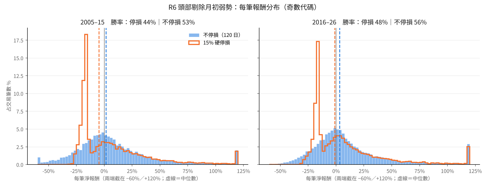

# M-184 結果：R6 頭部剔除月初弱勢｜交易報酬分布：15% 硬停損 vs 不停損（奇數代碼）

進場 t+1 開盤；S15＝收盤跌破進場 ×0.85 次日開盤出場、最長 120 日；NS＝不停損持有；皆扣來回 0.77%。

## 2005–15（10,465 筆）

| 版本 | 平均 | 中位數 | 勝率 | > +2% 比例 | P5 | P25 | P75 | P95 |
|---|---|---|---|---|---|---|---|---|
| S15 15% 硬停損（≤120 日） | +6.73% | -4.66% | 44.5% | 41.9% | -22.1% | -17.1% | +18.4% | +74.8% |
| NS120 不停損 120 日 | +8.66% | +1.65% | 52.8% | 49.5% | -39.1% | -13.6% | +22.3% | +77.9% |
| NS60 不停損 60 日 | +4.24% | +0.29% | 50.9% | 45.9% | -29.0% | -10.4% | +13.9% | +50.1% |

被停損 4,543 筆（43%）：若不停損，120 日後轉正 19%、> +2% 17%、中位數 -16.1%、跌超過 −30% 21%；停損出場本身中位數 -17.5%。
未被停損 5,922 筆：勝率 79%、中位數 +14.5%。

## 2016–26（13,228 筆）

| 版本 | 平均 | 中位數 | 勝率 | > +2% 比例 | P5 | P25 | P75 | P95 |
|---|---|---|---|---|---|---|---|---|
| S15 15% 硬停損（≤120 日） | +9.51% | -1.18% | 48.1% | 44.8% | -21.4% | -16.2% | +18.3% | +80.0% |
| NS120 不停損 120 日 | +12.83% | +3.06% | 56.0% | 52.0% | -30.8% | -10.1% | +22.2% | +87.7% |
| NS60 不停損 60 日 | +6.72% | +1.31% | 53.7% | 48.0% | -23.8% | -8.1% | +13.7% | +55.0% |

被停損 4,931 筆（37%）：若不停損，120 日後轉正 21%、> +2% 19%、中位數 -14.7%、跌超過 −30% 14%；停損出場本身中位數 -17.0%。
未被停損 8,297 筆：勝率 77%、中位數 +11.5%。

---
編號 M-184（registry_M.md）｜程式版本 b1435cc（含未提交變更）｜資料 tw-data v1.1｜面板 2026-11-25 18:50｜執行 2026-11-25 19:53，19 秒｜本次新變體 0｜累計試驗 584
